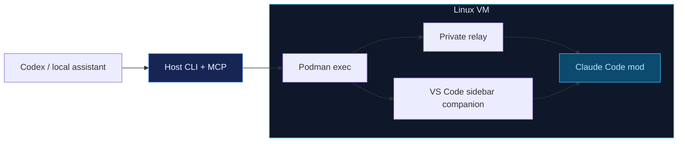

# Claude Code Orchestration Bridge

## Plugin for a better harness situation

I've been working on **Kaizen**, my own harness project for months, to get better control over that the code gen process from frontier models. Context management,
context freshness, bad code gen requiring tons of code review are the main problems. Fix those softmax attenion layers!!! 

Kaizen is still taking shape, and been doing experiments for improving what I can control.

One of those experiments has been running the development environment inside a VM to deal with the random issues of rules being ignored and random files and folders being written to where they are not supposed to be written. A Virtual Machine is a better sandbox to give a model freedom to work and keeping host clean and less frustration inducing work being done.

But that is not sufficient for better throughput. So how about using another frontier model to orchestrate Claude Code which is better at code gen, inside the VM.

This repository grew out of that experiment. It combines a **Claude Code mod plugin, an MCP bridge and a small VS Code sidebar companion**. The mod handles session controls. The companion keeps new and resumed conversations in the right sidebar. The MCP interface gives the orchestrating assistant tools for working with that session.

**This is a work in progress.** Codex has completed tasks through the bridge, with Claude's output written
back to a mapped host folder. I confirmed that works. But better code quality and reliable long-task supervision still need to be proven over time.

Throwing this into it's own repo for independent development made sense so here we are!

## How the pieces fit

The tested setup is a Windows host and a Linux Podman VM. Claude and its development tools run inside. Codex orchestration runs on the host. The bridge uses the existing environment and does not install the VM itself.

## What's working right now

The controls cover sending requests, reading status and events, inspecting acknowledgements, selecting model/effort,
retrieving native context reports, and opening or resuming the sidebar conversation.

Codex requests receive `CODEX:`. Supported llama.cpp, Ollama and vLLM integrations receive `OAR:` (Owner Assistant Request). The integration sets the identity outside the model's message text. An unknown sender gets an error for now.

Both prefixes identify **Owner Assistant Requests**. They operate within existing owner approved scope and cannot
grant, broaden or substitute for owner approval.

## Building and contributing

The [development guide](docs/development.md) covers dependencies, builds, checks, connection setup and updates.
Maintained source files are limited to **100 physical lines and 120 characters per line**, with UTF-8 and LF endings.
The build combines modules where needed. Conformance includes linting, type checking, tests and build verification.

This repo stays focused on source and builds. No AI instructions, session notes and local machine state are not kept in this repo. PRs and forks that improve functionality are welcome.

## License

Apache License 2.0. See [LICENSE](LICENSE) and [NOTICE](NOTICE).
